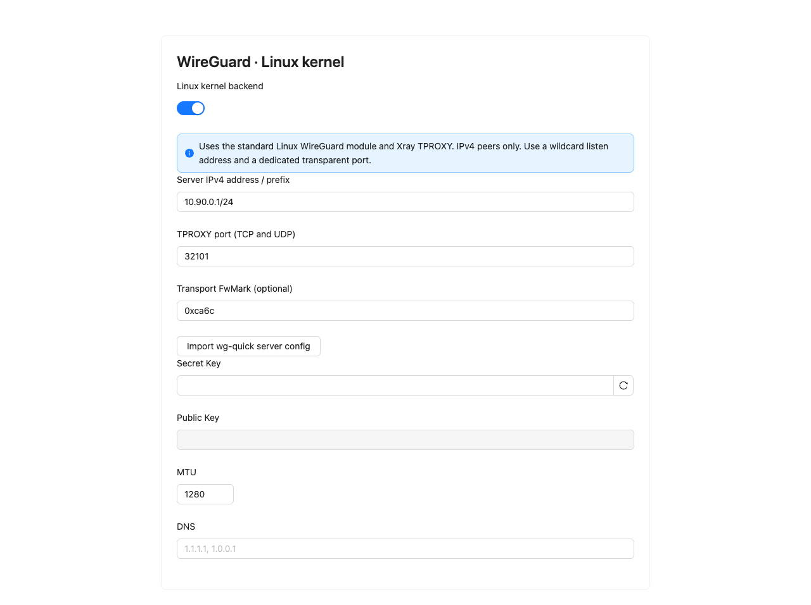

# Kernel WireGuard

WireGuard inbounds can opt into the Linux kernel backend with `settings.kernel: true`. Existing inbounds continue using Xray until explicitly changed. This backend is ordinary, unobfuscated WireGuard.

Requirements: Linux WireGuard support, `ip`, `wg`, `ss`, `nft`, `sysctl`, and the network administration privileges already required by the kernel AWG manager. The panel stores private configuration files in `XUI_DB_FOLDER/wireguard` with restricted permissions.

Create a WireGuard inbound, select Linux kernel, set the server IPv4 CIDR and an unused loopback TPROXY port, then add clients normally. The first version accepts IPv4 client /32 addresses in the server subnet. It sends TCP and UDP through the inbound's Xray TPROXY bridge and existing routing rules. It does not change the host default route or DNS. IPv6 is blocked on the managed interface. Unsupported traffic is dropped rather than forwarded around Xray.

Peer changes use `wg syncconf` and preserve other peer sessions. Changing server/device settings may recreate the interface. Disabling or deleting an inbound removes only its owned interface, routing rule, route, nftables table and configuration. Reconciliation retries failed configuration and cleanup operations.

The import preview accepts a standard server configuration, rejects shell hooks and AWG parameters, and returns a disabled draft for review. Save explicitly to create the inbound. Imported public keys do not recover client private keys; exports remain unavailable for those peers until the operator supplies their original private key. Existing external interfaces are not adopted automatically.

## Validation

Run the ordinary Go tests and frontend checks. On a disposable privileged Linux runner, install wireguard-tools, nftables and iproute2, then run:

```sh
sudo env PATH="$PATH" LUCX_WG_NETNS_TEST=1 go test -v -count=1 ./internal/lucx/wireguard -run '^TestKernelWireguardNetNS$'
```

The namespace test verifies real kernel handshakes, TCP/UDP TPROXY, compatibility with a connection-mark restore chain, reconciliation, closed forwarding when the listener is absent, and preservation of an unrelated WireGuard interface. `.github/workflows/kernel-wireguard.yml` runs this test and builds a Linux validation artifact.

For deployment, back up the database and binary, retain a tested rollback, and first validate a separate synthetic inbound. Verify DNS, HTTPS, routing, peer revocation, traffic accounting and existing tunnels before transferring externally managed interfaces.

## Form preview

The Linux kernel selector and explicit import action, rendered locally with empty key fields:



## Deployment validation (2026-10-21)

The artifact for `34c586e` from [the fork CI run](https://github.com/keonji/lucx-ui/actions/runs/39591865240) was installed on a Linux gateway with backup and scheduled rollback. A separate temporary inbound used independent local and external synthetic peers. Each passed 11 DNS/HTTPS samples over five minutes; the local client also reached a Russian HTTPS destination. Handshake timestamps advanced through two rekeys while the managed interface index and Xray PID stayed unchanged. Individual peer revocation blocked traffic; enabling it and making a fresh client handshake restored access. Traffic counters grew in the panel.

Existing routing rules enumerate inbound tags. The synthetic tag was temporarily added to the existing WG routing policy and then removed; the feature itself does not silently add an egress rule. Original routing/outbounds, client profiles and peer sets matched their pre-deployment hashes after cleanup. The temporary inbound, both client identities, namespaces, files, nftables table, route/rule and API token were removed.

The existing externally managed WG interface was preserved. Transferring its ownership from wg-quick and another provisioning service requires a separate operator cutover; installing this feature does not perform that transfer. These checks establish functional behavior on the tested gateway and Linux CI runner, not long-term performance or resistance to provider filtering.
